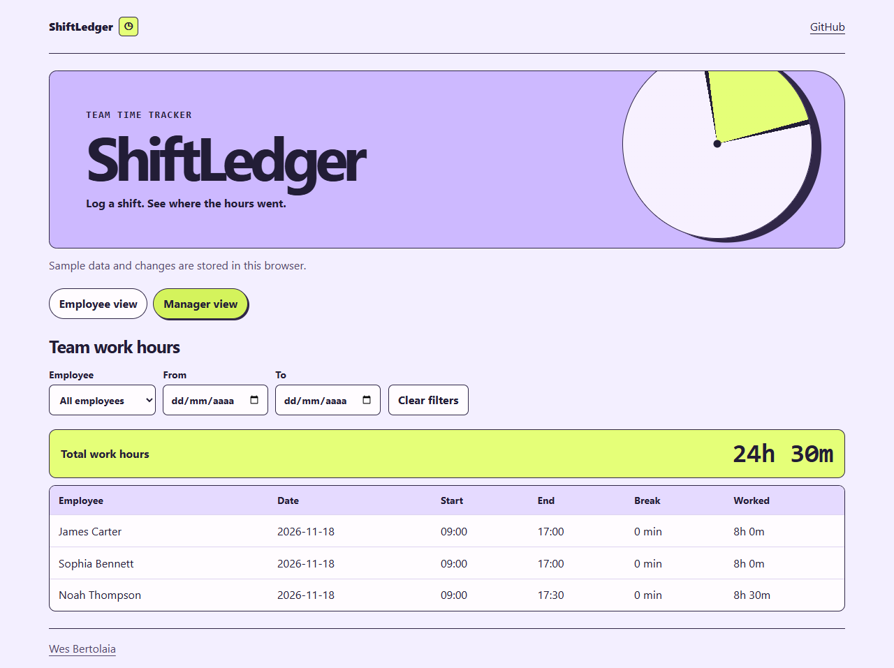

# ShiftLedger

An employee time tracking demo. Built with React.

First-time users can load example hours, review them, and save their first shift. Employees enter their shifts and breaks. Managers review entries, filter by employee or date range, and see total worked time. Shift validation rejects invalid durations and overlapping entries.

The demo uses fictional records and stores changes in the browser. Employee and manager views are selectable demo roles.



[Open the live demo](https://wesleybertolaia.github.io/shiftledger/)

## Browse the code

- [React application](./shiftledger.jsx)
- [Browser storage and date utilities](./storage.js)

## Run the demo locally

Use Node.js 24.

```sh
npm ci
npm run build
npm start
```

Open http://localhost:4173.
